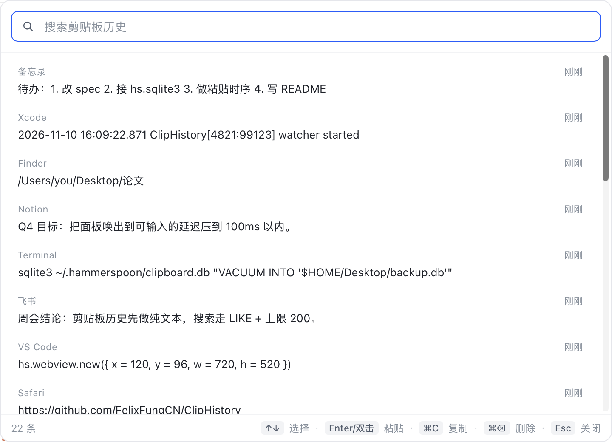

# ClipHistory

Hammerspoon 上的本地剪贴板历史。纯文本、永久保留、不联网。



## 使用

- `⌘B` 打开/关闭面板（会接管所有 App 的 ⌘B）。
- 输入即搜，空格分隔多个关键词为 AND；`↑` `↓` 选择，`Enter` 或双击粘贴，`⌘C` 只复制，`⌘⌫` 删除当前行，`Esc` 关闭。
- 点击面板外任意区域，面板自动关闭。
- 面板任意位置按住可拖动（搜索框、滚动条除外），位置会记住。
- `⌘=` 放大字体、`⌘-` 缩小字体、`⌘0` 复位；字号会记住。
- 面板只做浅色主题。

## 数据

- 位置：`~/.hammerspoon/clipboard.db`（WAL 模式，权限 600）。
- 明文存储，永久保留，不做清理；不提供「全部清空」。
- 复制来源 App 会记录在库里；被标记为 `org.nspasteboard.ConcealedType` / `TransientType` / `AutoGeneratedType` 的内容（密码管理器等）不会入库。

**隐私提醒**：其余内容（包括你从任何 App 复制的密码、令牌）会以明文长期留在本机，任何以你身份运行的程序都能读到。

## 备份

WAL 模式下不要直接 `cp` 主库文件（最近的数据还在 `clipboard.db-wal` 里）：

```bash
sqlite3 ~/.hammerspoon/clipboard.db "VACUUM INTO '$HOME/Desktop/clipboard-backup.db'"
```

或先 `PRAGMA wal_checkpoint(TRUNCATE)` 再拷整个目录。

## 清空

没有面板内的清空功能。需要清库时退出 Hammerspoon，删除 `clipboard.db`、`clipboard.db-wal`、`clipboard.db-shm`，下次启动会自动重建。

## 安装到另一台 Mac

1. 安装 Hammerspoon 1.1.x（使用 Lua 5.4），启动一次。
2. 把整个 `ClipHistory` 目录复制到目标机器的 `~/.hammerspoon/ClipHistory`。
3. 在 `~/.hammerspoon/init.lua` 末尾追加（已有配置就合并，不要覆盖）：

```lua
local ok, err = pcall(function() require("ClipHistory").start() end)
if not ok then print("ClipHistory start failed: " .. tostring(err)) end
```

4. 重载 Hammerspoon 配置（菜单栏图标 → Reload Config），按提示授予「辅助功能」权限。
5. 复制一段文字，按 `⌘B` 验证。

不需要复制 `clipboard.db`：每台机器首次启动都会自动建库。历史记录是本机的明文数据，要迁移就单独拷 `clipboard.db`、`clipboard.db-wal`、`clipboard.db-shm`（先退出 Hammerspoon），并注意明文风险。面板位置也存在本机 `hs.settings` 里，不会跟着目录走。

## 第三方依赖

面板内置 Vue 3（MIT）与 Arco Design Vue（MIT），随仓库打包，离线可用。

## 版本

- **1.1.0** — 面板任意位置可拖动；`⌘=` / `⌘-` 缩放字体，`⌘0` 复位（字号持久化）
- **1.0.0** — 首个版本：捕获、搜索、粘贴、删除、失焦关闭

## 文件

```
ClipHistory/
  init.lua      模块入口、热键
  config.lua    常量（热键、面板尺寸、上限）
  db.lua        SQLite 读写、搜索、迁移
  capture.lua   剪贴板捕获、过滤、来源记录
  panel.lua     hs.webview 面板与 JS 桥
  ui/           面板前端（panel.html 是生产面板，index.html 是 mock demo）
```
